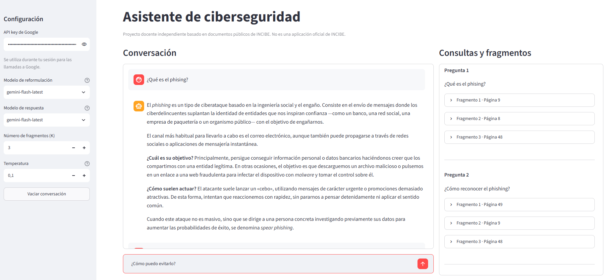
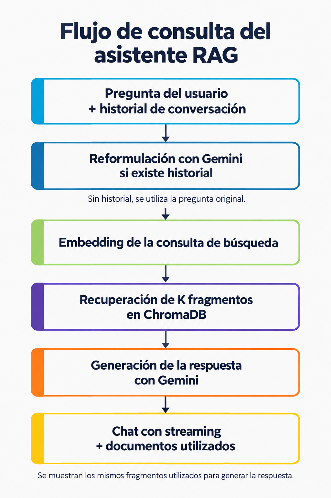

# Asistente de ciberseguridad INCIBE RAG

Asistente conversacional que responde preguntas sobre ciberseguridad a partir de documentos públicos de INCIBE. Combina una interfaz web con Streamlit, una base de datos vectorial ChromaDB y modelos de Google Gemini para recuperar información y generar respuestas con contexto documental.

**Proyecto independiente de carácter educativo, sin afiliación con INCIBE.** Las respuestas pueden contener errores y no sustituyen los canales oficiales de ayuda.

<p align="center">
  
</p>

La interfaz reúne los controles de configuración a la izquierda, el chat en la zona central y las consultas de búsqueda con sus fragmentos recuperados a la derecha.

## Funcionalidades

La aplicación permite conversar sobre amenazas y medidas de protección, realizar preguntas de seguimiento y consultar los fragmentos utilizados para elaborar cada respuesta.

- **Chat con streaming:** las respuestas aparecen progresivamente y se muestran con formato Markdown.
- **Dos modelos configurables:** uno reformula las preguntas con historial y otro genera las respuestas. Ambos selectores permiten elegir una opción o escribir un identificador de Gemini.
- **Clave aportada por cada usuario:** las llamadas a Google utilizan la API key introducida en su sesión.
- **Recuperación configurable:** el parámetro K determina el número de fragmentos que se solicita recuperar.
- **Temperatura ajustable:** control entre 0 y 2, con incrementos de 0,1, aplicado al modelo de respuesta.
- **Historial de recuperación:** un panel con scroll conserva las consultas de búsqueda y sus fragmentos, organizados por turno.
- **Reinicio de la conversación:** el botón «Vaciar conversación» borra los mensajes y las recuperaciones, conservando los controles.

## Funcionamiento

RAG (*Retrieval-Augmented Generation*) es una técnica que incorpora información recuperada de documentos al contexto de un modelo de lenguaje para generar una respuesta.

En esta aplicación, cada pregunta sigue este recorrido:

<p align="center">
  
</p>

En el primer turno no hay mensajes anteriores, por lo que se busca información utilizando la pregunta tal como la ha escrito el usuario. Por ejemplo, si escribe «¿Qué es el phishing?», ese mismo texto se utiliza para recuperar los fragmentos de la base de datos.

A partir del segundo turno, la pregunta puede depender de lo que se ha hablado antes. Si el usuario escribe «¿Y cómo puedo evitarlo?», esa frase por sí sola no indica qué quiere evitar. El modelo de reformulación recibe la pregunta actual y los mensajes anteriores y genera una consulta que se entiende sin leer la conversación, por ejemplo: «¿Cómo puedo evitar el phishing?». Esta consulta reformulada se utiliza para buscar los fragmentos; la pregunta original se conserva en el chat y se envía al modelo que genera la respuesta.

El embedding se calcula sobre la consulta de búsqueda resultante. El modelo de respuesta recibe la pregunta original, el historial y los fragmentos recuperados. Estos se recuperan una sola vez: el panel derecho muestra exactamente los mismos documentos utilizados para generar la respuesta.

## Requisitos

Para ejecutar la aplicación necesitas Python 3.11, conexión a Internet y una API key de Google con acceso a los modelos de Gemini que selecciones y al modelo de embeddings configurado. Las instrucciones siguientes utilizan `uv` para gestionar el entorno y las dependencias.

La carpeta completa `chroma_db/` debe estar presente junto a `app.py`. Contiene la base documental ya indexada, por lo que no es necesario ejecutar un indexador para utilizar la aplicación.

Recursos para preparar el entorno y obtener una clave:

LINK: https://docs.astral.sh/uv/getting-started/installation/

LINK: https://aistudio.google.com/apikey

## Instalación

Descarga el proyecto o clona su repositorio y abre una terminal en la carpeta `asistente-ciberseguridad-incibe-rag`.

Crea el entorno e instala las dependencias:

```bash
uv venv .venv_rag_st --python 3.11
uv pip install --python .venv_rag_st -r requirements.txt
uv pip check --python .venv_rag_st
```

Activa el entorno antes de ejecutar la aplicación.

**Windows — PowerShell:**

```powershell
.\.venv_rag_st\Scripts\Activate.ps1
```

**macOS y Linux:**

```bash
source .venv_rag_st/bin/activate
```

## Ejecución

Con el entorno activado, inicia el servidor:

```bash
streamlit run app.py
```

Abre en el navegador la dirección local que muestra la terminal, normalmente `http://localhost:8501`. Para detener el servidor, pulsa `Ctrl+C` en la terminal.

En posteriores ejecuciones solo necesitas abrir la carpeta del proyecto, activar el entorno y lanzar el mismo comando.

## Uso de la interfaz

La interfaz se distribuye en tres zonas: configuración a la izquierda, conversación en el centro y consultas con fragmentos a la derecha. El chat central ocupa el mayor espacio.

1. Introduce tu **API key de Google** en el campo oculto del panel izquierdo.
2. Selecciona el **modelo de reformulación** y el **modelo de respuesta**. Para utilizar otro, escribe o pega su identificador y confirma la selección.
3. Ajusta el **número de fragmentos (K)** y la **temperatura**.
4. Escribe una pregunta en el campo inferior del chat.
5. Examina la respuesta y despliega los fragmentos del panel derecho para consultar su texto completo, fuente y página.

Los cambios de modelo, K y temperatura se aplican a las siguientes preguntas y conservan la conversación existente. La reformulación mantiene temperatura 0; el control de la interfaz solo modifica la generación de respuestas. Si la colección tiene menos registros que K, pueden recuperarse menos fragmentos de los solicitados.

El botón **«Vaciar conversación»** borra ambos historiales y hace que la siguiente pregunta se procese sin mensajes anteriores. No elimina la base documental ni reinicia los controles.

### Preguntas de ejemplo

Puedes iniciar una conversación con «¿Qué es el phishing y cómo puedo reconocerlo?» y continuar con «¿Y cómo puedo evitarlo?» o «¿Puedes resumirlo en tres recomendaciones?».

Otras consultas posibles son «¿Qué diferencias hay entre phishing, smishing y vishing?» y «¿Qué señales pueden indicar que una tienda online es fraudulenta?».

Para observar los límites del corpus, prueba una pregunta ajena a la ciberseguridad. El asistente recibe instrucciones para reconocer la información insuficiente, aunque ese comportamiento no está garantizado.

## Configuración

El archivo `config.py` centraliza las rutas y los valores iniciales. Las rutas se calculan desde la ubicación del archivo, de modo que no dependen del directorio desde el que se inicia el servidor.

| Parámetro | Valor inicial | Función |
|---|---|---|
| `CHROMA_DB_PATH` | `chroma_db/` | Ubicación de la base vectorial. |
| `COLLECTION_NAME` | `ciberseguridad` | Colección que se abre en ChromaDB. |
| `EMBEDDING_MODEL` | `gemini-embedding-001` | Modelo que codifica las consultas de búsqueda. |
| `MODELOS` | `gemini-flash-latest`, `gemini-pro-latest` | Opciones iniciales de los selectores de modelos. |
| `TEMPERATURE` | `0.1` | Temperatura inicial de las respuestas. |
| `SEARCH_K` | `2` | Número inicial de fragmentos solicitados. |

La disponibilidad de los modelos depende del servicio de Google y del acceso de la clave utilizada. Los selectores permiten introducir otro identificador sin modificar el código.

## Base documental

La base de datos vectorial es una colección de textos, embeddings y metadatos que permite localizar fragmentos relacionados semánticamente con una consulta. La base incluida procede de las guías públicas de INCIBE `guia_ciberseguridad_para_todos.pdf` y `osi-guia-ciberataques.pdf`.

La aplicación abre una colección existente y no indexa documentos al arrancar ni durante las interacciones. Para ejecutarla basta con la carpeta completa `chroma_db/`: los PDF originales no son necesarios en tiempo de consulta.

El repositorio ya incluye la base de datos creada en `chroma_db/`, con los documentos de `corpus/` indexados mediante el modelo **`gemini-embedding-001`**. Los embeddings de los documentos ya están calculados. Cada búsqueda calcula el embedding de su consulta con la clave del visitante. El modelo de embeddings, sus dimensiones y el nombre de colección deben ser compatibles con la base preparada.

Si cambian los documentos, la fragmentación o el modelo de embeddings, ejecuta `indexador.py` para reconstruir la base a partir de los PDF incluidos en `corpus/`.

Antes de copiar o sustituir la base, detén la aplicación y copia toda la carpeta, incluidos los índices. No basta con conservar `chroma.sqlite3`. Al trasladarla a otro entorno, comprueba la compatibilidad con las versiones de ChromaDB instaladas.

## Indexación documental

La indexación documental es el proceso que extrae el texto de los PDF, lo divide en fragmentos, calcula sus embeddings y los guarda con sus metadatos en ChromaDB. El script `indexador.py` permite realizar este proceso de forma independiente de la interfaz.

Si utilizas la base incluida, no necesitas ejecutarlo. Para reconstruirla, detén primero Streamlit, instala las dependencias actualizadas y ejecuta `python indexador.py`. Si existe la variable de entorno `GOOGLE_API_KEY`, el script la utiliza; si no, solicita la clave en la terminal con entrada oculta. No la guarda en archivos. La clave introducida en la interfaz no se transfiere al script. Los siguientes comandos muestran la alternativa de configurar la variable antes de ejecutar.

Con el entorno activado, en PowerShell:

```powershell
uv pip install -r requirements.txt
$env:GOOGLE_API_KEY = "TU_API_KEY"
python indexador.py
```

En macOS o Linux:

```bash
uv pip install -r requirements.txt
export GOOGLE_API_KEY="TU_API_KEY"
python indexador.py
```

Sustituye el marcador por tu clave y no la guardes en archivos publicados. La ejecución calcula embeddings con Google y consume la cuota del proyecto asociado.

**Cada ejecución elimina todas las colecciones de la base local configurada y la reconstruye.** No ejecutes el indexador mientras el chat está utilizando esa base. El script conserva los PDF originales y muestra el progreso y una inspección de los registros guardados.

Los parámetros `CHUNK_SIZE = 5000` y `CHUNK_OVERLAP = 1000` de `config.py` controlan el tamaño y el solapamiento de los fragmentos, expresados en caracteres. Los PDF deben contener texto extraíble; el script no incorpora OCR para documentos escaneados.

## Credenciales e historial

La clave se introduce en un campo de contraseña y se pasa explícitamente a los clientes de Google. El código no la escribe en archivos ni modifica variables de entorno compartidas, y tampoco utiliza una caché global de credenciales.

En un despliegue web, la clave pasa por el servidor de la aplicación para realizar las llamadas a Google. El consumo se aplica al proyecto asociado a esa clave, según sus cuotas y condiciones de facturación. Las consultas, el contexto documental y el historial utilizado en los prompts se envían al proveedor para procesar las solicitudes.

La conversación se conserva en `st.session_state` para cada sesión. No se almacena en una base de datos de conversaciones y una recarga de la página puede reiniciarla. El historial completo de los turnos anteriores se incorpora a las llamadas correspondientes: las conversaciones largas aumentan el consumo de tokens y pueden alcanzar el límite de contexto del modelo.

No incluyas claves en los mensajes, en el código ni en archivos publicados. El `.gitignore` excluye los entornos virtuales, archivos `.env`, secretos locales de Streamlit y archivos temporales de Python.

## Despliegue en Streamlit Community Cloud

Streamlit Community Cloud es un servicio que ejecuta aplicaciones Streamlit a partir de un repositorio de GitHub. Este proyecto sitúa el punto de entrada y sus dependencias en la raíz para facilitar su despliegue.

**Antes de desplegar la aplicación, debe haberse ejecutado `indexador.py` para crear la base documental. En este repositorio ese paso ya está realizado:** la carpeta `chroma_db/` contiene los documentos indexados con **`gemini-embedding-001`**. Si utilizas esa base sin cambiar el corpus ni la configuración de indexación, no necesitas volver a ejecutar el script.

Si partes de una base inexistente o modificas los documentos, la fragmentación o el modelo de embeddings, ejecuta localmente `python indexador.py` antes del despliegue y sube después la carpeta completa `chroma_db/` actualizada. El servicio desplegado abre esa base preparada; no ejecuta el indexador automáticamente.

1. Publica el proyecto en GitHub, incluyendo la carpeta completa `chroma_db/`.
2. Comprueba localmente las dependencias y fija las versiones que hayas validado, especialmente ChromaDB y su integración con LangChain. El archivo actual no fija todas las versiones.
3. En Community Cloud, conecta tu cuenta de GitHub y crea una aplicación.
4. Selecciona el repositorio, la rama `main` y `app.py` como archivo principal.
5. En las opciones avanzadas, selecciona Python 3.11 si está disponible.
6. Inicia el despliegue y comprueba la instalación y apertura de la base en los registros del servicio.
7. Introduce una clave en la interfaz y prueba una pregunta inicial, una de seguimiento, el streaming y el reinicio de la conversación.

No tienes que guardar tu API key de Google en la configuración de Streamlit Community Cloud. Cuando una persona abre la aplicación, debe introducir su propia clave en el panel izquierdo. La aplicación utiliza esa clave para realizar las llamadas a Google durante su sesión, de modo que el consumo se asocia al proyecto de Google de esa persona.

La carpeta `chroma_db/` debe subirse a GitHub junto con el código. Al desplegar la aplicación, Community Cloud descarga también esa carpeta y abre la base de datos que ya contiene los documentos indexados. Por tanto, no hay que ejecutar `indexador.py` en Community Cloud.

Después del despliegue, realiza una pregunta de prueba para comprobar que la aplicación puede abrir la base y recuperar fragmentos. La base se ha preparado en Windows y Community Cloud ejecuta la aplicación en Linux; además, las versiones de ChromaDB pueden ser distintas. Si aparece un error al abrir la colección o cargar los índices, revisa esas versiones y, si es necesario, vuelve a generar la base en un entorno compatible con el despliegue.

LINK: https://docs.streamlit.io/deploy/streamlit-community-cloud/deploy-your-app/deploy

## Estructura del proyecto

Los archivos separan la interfaz, la configuración y la lógica de recuperación y generación:

```text
asistente-ciberseguridad-incibe-rag/
├── app.py
├── config.py
├── indexador.py
├── prompts.py
├── rag.py
├── requirements.txt
├── README.md
├── .gitignore
├── corpus/
│   ├── guia_ciberseguridad_para_todos.pdf
│   └── osi-guia-ciberataques.pdf
└── chroma_db/
    ├── chroma.sqlite3
    └── ...
```

| Archivo | Responsabilidad |
|---|---|
| `app.py` | Controles, conversación por sesión, streaming y presentación de documentos. |
| `config.py` | Rutas, colección, opciones de modelos y parámetros iniciales. |
| `indexador.py` | Lectura de PDF, fragmentación y reconstrucción de la base vectorial. |
| `prompts.py` | Instrucciones de reformulación y generación de respuestas. |
| `rag.py` | Configuración de clientes, recuperación de fragmentos y ejecución de los modelos. |
| `requirements.txt` | Dependencias para ejecutar la aplicación. |

## Resolución de problemas

Si la aplicación no completa una consulta, revisa la configuración y la disponibilidad del servicio. Los errores del proveedor no se muestran íntegramente en la interfaz para evitar exponer información sensible.

| Problema | Comprobación |
|---|---|
| Falta la base de datos | Confirma que existe `chroma_db/chroma.sqlite3` y que has incluido también el resto de archivos de la base. |
| No se puede abrir la colección | Revisa `COLLECTION_NAME` y la compatibilidad de la versión de ChromaDB. |
| La consulta falla | Comprueba la clave, los identificadores de modelos, las cuotas y la conexión a Internet. |
| No aparece el campo de escritura habilitado | Introduce una clave no vacía en el panel izquierdo. |
| Un modelo no está disponible | Selecciona o escribe otro modelo de Gemini al que tenga acceso tu clave. |
| El despliegue falla al instalar | Revisa los registros del servicio, la versión de Python y las dependencias declaradas. |

## Limitaciones

La aplicación tiene fines didácticos: muestra un ejemplo de extremo a extremo (E2E) de una arquitectura RAG, desde la indexación de documentos hasta la recuperación de fragmentos y la generación de respuestas mediante una interfaz de chat. La recuperación puede seleccionar información insuficiente o poco pertinente y el modelo puede generar respuestas incorrectas. Consultar los fragmentos ayuda a revisar el fundamento de la respuesta, pero no sustituye la comprobación de las fuentes.

El proyecto no incorpora actualización automática del corpus, indexación desde la interfaz ni persistencia de las conversaciones entre sesiones.